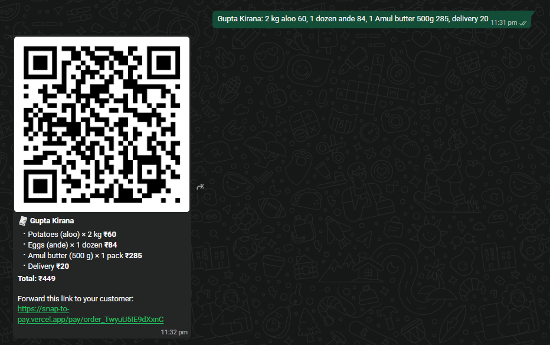
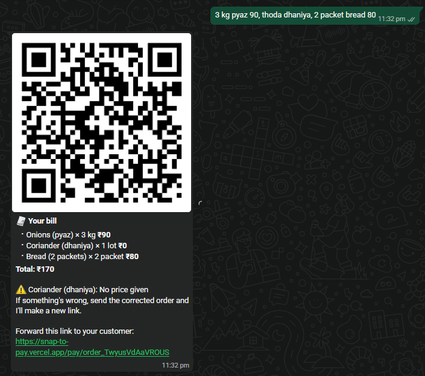
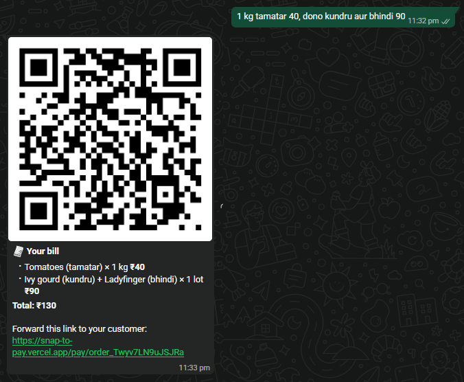
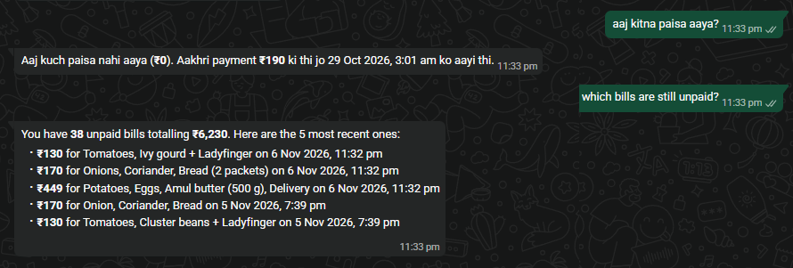

# Snap-to-Pay

**Live:** https://snap-to-pay.vercel.app (Razorpay test mode, no real money moves)

Snap a bill, paste a WhatsApp order or speak it. Gemini turns it into an itemized bill, the
shopkeeper checks it, and the customer pays through Razorpay from a QR code or a WhatsApp link.
The same works on WhatsApp itself, and an AI assistant answers questions about the shop's sales.

## What it does

- **Reads messy input:** handwritten kirana bills, Hinglish WhatsApp orders, spoken orders.
  Item names are translated, missing line totals are worked out, and GST or delivery become
  separate charges. A price that covers several items becomes one combined line.
- **Flags what to double-check:** lines with no price or hard-to-read values show in amber.
- **Every value is editable** before collecting; quantity × rate and the line amount stay in step.
- **Collects payment:** a Razorpay order per bill, our own `/pay/[orderId]` page with Razorpay
  Checkout, a QR code and a WhatsApp share link. After paying, the customer lands on a receipt
  with an invoice they can save as PDF or share.
- **Payments history** (`/payments`): collected today, paid and waiting bills, read live from Razorpay.
- **Sales assistant** on the Payments page: ask "How much did I collect?", "Which bills are
  unpaid?", "What sells the most?" or "aaj kitna aaya?". Gemini answers through function calling
  over Razorpay data and can prepare WhatsApp reminder buttons for unpaid bills.
- **WhatsApp bot:** send a bill photo, a typed order or a voice note and get the bill with a QR
  code and pay link back in one message; ask sales questions the same way.
- **Sample bills** show saved Gemini answers instantly, with no AI quota used.

## See it on WhatsApp

Real messages to the bot, in Razorpay test mode. The empty middle of each chat is cropped out.

**A typed order** becomes one reply with the QR code, the bill and a pay link. The total is added
up by the server, and the "500g" stays in the item name instead of becoming a quantity.



**A missing price is flagged**, not guessed: "thoda dhaniya" has no price, so the bot says so.



**One price for two items** stays one line: "dono kundru aur bhindi 90" isn't split or invented.



**Sales questions** are answered from live Razorpay data, in the language they're asked in.



## Try the WhatsApp bot

The bot runs on Twilio's free WhatsApp Sandbox.

1. Send `join almost-cloud` to **+1 415 523 8886** on WhatsApp (the join lasts 72 hours).
2. Send `hi`, then a bill photo, an order such as `2 kg aloo 60, 1 paneer 120`, a voice note,
   or a question such as `which bills are still unpaid?`

Replies take 1–10 seconds. If the free AI is slow, the bot says so; reply `ok` to get the result.

## Why the total can be trusted

- Gemini's answer must match a Zod schema (used as its structured-output schema too).
- The server re-adds every line itself; the browser's amount is never trusted.
- The sales assistant's tools do all the arithmetic, so the model only repeats numbers it was given.
- "Paid" comes from Razorpay's own order status, and Checkout's signature is verified with HMAC.
- Only `rzp_test_` keys are accepted, so this demo can never move real money.

## How the WhatsApp bot works

- Twilio posts each message to `/api/whatsapp`; the request's `X-Twilio-Signature` is checked.
- The reply goes back inside the webhook response (TwiML) within a 12-second budget, because
  Twilio waits 15 seconds. Slower AI work keeps running and the next `ok` returns it.
- If Gemini finds no items in a message, it is treated as a question for the sales assistant.
- Bills made through the bot store the shopkeeper's number in a private Razorpay note that the
  public pages never read. With a Razorpay `order.paid` webhook pointed at
  `/api/razorpay/webhook`, the bot can message "₹X received" when the customer pays.

## Stack

Next.js 16 (App Router) · React 19 · Tailwind CSS 4 · Gemini (`gemini-3.5-flash-lite`, falling back
to `gemini-3.6-flash` when overloaded) via `@google/genai` · Razorpay Orders API + Checkout ·
Twilio WhatsApp · Zod · Vercel.

No database: each bill travels with its Razorpay order as notes.

## Limits

- Live AI reads: 10 per hour per visitor (or WhatsApp number) and 300 per day overall.
  Assistant questions: 20 per hour. Payment links: 20 per hour.
  Counts use Upstash Redis when `UPSTASH_REDIS_REST_URL` / `UPSTASH_REDIS_REST_TOKEN` are set,
  otherwise memory (per server instance).
- Each Gemini call times out after 25 seconds and moves on to the next model.

## Run it locally

```bash
npm install
cp .env.example .env.local   # add a Gemini key, Razorpay test keys and (optionally) Twilio keys
npm run dev
```

Set `WHATSAPP_DRY_RUN=1` to log WhatsApp messages instead of sending them.

Pushes to `main` deploy to Vercel automatically.
